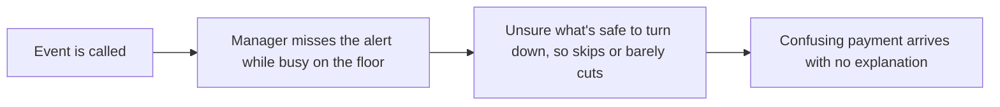
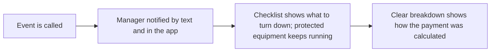

# Grid Event Response App

**A product management case study** · demand response for a virtual power plant

> **Concept project.** This is a practice scenario I worked through to build product management skills. It is not real client or employer work, and no real company, customer, or data is involved.

**Author:** Francesca Djoufack · [github.com/FrannyBrave](https://github.com/FrannyBrave)

---

## At a glance

| | |
|---|---|
| **Problem** | Businesses skip grid events or barely cut usage, and don't understand how they were paid |
| **Main user** | Facility manager or store manager on shift |
| **Buyer** | Business owner, or an energy manager / head of operations at larger companies |
| **Version one** | Text and app alerts, a safe-to-turn-down checklist, a clear payment breakdown |
| **Key call** | Swapped the live savings view for alerts: nothing else matters if the manager never sees the event |
| **Headline metrics** | Participation, performance, fewer payment disputes and satisfaction (product); renewal (business) |

**Contents:** [The moment](#the-moment) · [Problem validation](#problem-validation-published-research) · [Users](#users-and-personas-assumed-to-be-validated) · [Problem statement](#problem-statement) · [User research plan](#user-research-plan) · [Edge cases](#edge-cases-and-acceptance-criteria) · [Prioritization](#opportunities-and-prioritization) · [Version one scope](#version-one-scope) · [Trade-offs](#trade-offs) · [Security](#security-and-data) · [Success metrics](#success-metrics) · [Launch plan](#launch-plan) · [Go-to-market](#go-to-market) · [Workflow](#workflow-before-and-after) · [Impact](#expected-impact-by-persona)

---

## The moment

*An imagined scenario to show the problem:*

**Tuesday, 2:58pm.** It's the hottest day of July. The grid operator calls an event, and an alert email goes to Dana, a grocery store manager.

**3:00–4:30pm.** Dana is on the floor handling a late delivery. She doesn't check her email.

**4:35pm.** She sees the alert. The event is half over. She isn't sure whether turning down the air conditioning would put the produce section at risk, so she does nothing.

**Next month.** A smaller payment arrives with no explanation. She doesn't know why, and she's not sure the program is worth it.

## Problem validation: published research

| Finding | Source |
|---|---|
| The U.S. Department of Energy estimates virtual power plants could reach **80–160 GW by 2030**, about **10–20% of peak demand** | [DOE Pathways to Commercial Liftoff: Virtual Power Plants, via APPA](https://www.publicpower.org/periodical/article/doe-report-addresses-integrating-virtual-power-plants-grid) |
| Reaching that scale could save around **$10 billion a year** in grid costs | Same source |

Virtual power plants only work if enrolled sites actually respond during events, so participation is the whole game. The company, users and figures elsewhere in this case study are hypothetical.

### Assumptions to test

1. Missed alerts are a main reason businesses skip events.
2. Managers skip events because they're afraid of hurting operations, not because they don't care.
3. A clear payment breakdown reduces disputes and builds trust in the program.
4. Managers want to stay in control before they'd accept automation.

---

## Context

A company runs a virtual power plant. Businesses such as grocery stores, factories and office buildings sign up. When the electricity grid is under stress, the grid operator calls an **event**: a few hours, usually on the hottest summer days or the coldest winter days, when demand is so high the grid risks running short. The power stays on, but the company asks enrolled businesses to cut their usage, for example by turning down air conditioning or pausing some machines. Businesses that cut their usage get paid.

There are two problems:

- Many businesses skip events or barely cut their usage.
- Afterwards, they often don't understand how their payment was calculated.

## Users and personas (assumed, to be validated)

- **Facility manager or store manager on shift:** the person on site who actually turns equipment down during an event.
- **Finance or business owner:** receives the payment and wants to understand it.
- **Our operations team:** sends the event alerts.

**Focus: the facility or store manager first.** They're the ones who take action. If they don't respond, nothing gets cut and the business doesn't get paid.

**Why managers skip events:**

- They need power to keep the business running. A grocery store can't let its freezers warm up, and customers still need to be comfortable.
- They miss the alert because they're busy on the floor.
- They don't know exactly what's safe to turn down.

## Problem statement

Facility managers need a quick, safe way to respond to events, because today alerts are easy to miss and it's unclear what they can turn down without hurting the business, which leads to skipped events and missed payments.

## User research plan

Before building anything, I would confirm both problems are real by talking directly with store and facility managers, focusing on real, recent events:

- *"How many times have you received a payment you didn't understand?"*
- *"Think about the last event that was called. How did you find out about it?"*
- *"How did you respond to it, and how was your building affected?"*
- *"How did you decide what to turn down?"*

**Our own data:** the company's event records show which sites skipped events and how much each site actually cut, compared with what it committed to.

## Edge cases and acceptance criteria

- Cutting usage could put critical equipment at risk, such as freezers full of food
- The event is called at short notice
- The event happens overnight, when nobody is on site
- It's dangerously hot, so turning down the air conditioning isn't safe
- The manager has to cancel partway through the event

**Key decision:** businesses can mark critical equipment, like freezers, as protected. Protected equipment is never part of an event plan, and the event still goes ahead with everything else.

**Protected equipment**
> **Given** equipment marked as protected, **when** an event is called, **then** that equipment is never included in the event plan and keeps running normally.

## Opportunities and prioritization

Scored with **RICE** (Reach × Impact × Confidence ÷ Effort). These are my own estimates for this scenario: reach on a 1–10 scale, impact 1–3, effort in weeks.

| Opportunity | Reach | Impact | Confidence | Effort | RICE |
|---|---|---|---|---|---|
| Text and app alert when an event is called | 10 | 3 | 90% | 2 | **13.5** |
| Checklist of what's safe to turn down | 8 | 2 | 80% | 3 | **4.3** |
| Clear payment breakdown afterwards | 7 | 2 | 80% | 3 | **3.7** |
| Live view of power savings during the event | 6 | 1 | 50% | 5 | **0.6** |
| Automatic control (opt-in) | 5 | 3 | 30% | 10 | **0.5** |

**Reading the scores:** alerts score highest because every other feature depends on the manager seeing the event. The live savings view scores far lower, which is why I swapped it out of version one.

## Version one scope

**In version one:**

1. **Text and app alert when an event is called.** Missed alerts are a main reason events get skipped. If the manager never sees the event, nothing else matters.
2. **A simple checklist of what's safe to turn down.** Solves the "not sure what's safe" problem.
3. **A clear payment breakdown afterwards.** Solves the payment confusion.

**Later on the roadmap:** a live view of power savings during the event, and automatic control as an opt-in.

**How the scope changed:** I first chose the live view as my third feature. I swapped it for the alert, because the checklist and the live view are useless if the manager never sees that an event has started.

## Trade-offs

**Manual vs. automatic control.** I chose manual for launch. Automatic control would make responding easier, but we don't want to risk managers feeling like the system has taken over their building without them knowing what's going on. The approach is to start manual, earn their trust, and later offer automatic control as an opt-in for businesses that want it.

## Security and data

- **Data confidentiality and protection:** a site's energy and payment data is kept confidential
- **Encryption:** data is encrypted at rest and in transit
- **Role-based access:** the store manager can respond to events, while only the owner or finance can see payment details
- **Audit trail:** a log of who received each alert, who responded, and what actions were taken
- **Verified alerts:** alerts must be confirmed as coming from our company, so a fake message can't trick a manager into shutting equipment down

## Success metrics

- **Participation:** the share of events that managers respond to, with far fewer skipped events
- **Performance:** how much power businesses actually cut compared with what they committed to, which matters most to the grid
- **Fewer payment disputes:** fewer payment questions and complaints coming into support
- **Customer satisfaction:** managers find the app easy to use and understand their payments

## Launch plan

1. **Internal testing:** product, engineering and QA test the app, along with our operations team, who send event alerts and can run practice events.
2. **Pilot:** a small group of store and facility managers, run in spring or fall when the grid is calm. Since real events are rare then, we send practice test events, so managers learn the app before the first big heatwave.
3. **Full rollout:** goes ahead only when all of these are true:
   - managers respond to most test events
   - they cut what they committed to
   - payment questions and complaints drop
   - managers say the app is easy to use and they understand their payments

## Go-to-market

- **Buyer:** the business owner for a single store. For a large chain or a factory, it's usually an energy manager or the head of operations, since they handle the energy bills.
- **Pitch:** many store owners are dealing with high energy bills. With our product, you can earn extra money from the energy you already use, just by easing off for a few hours on a handful of days a year, without putting your freezers or your customers at risk. And you'll see exactly how every dollar was calculated.

**Business metrics**

- **Renewal (headline metric):** how many businesses stay enrolled
- **Enrollment after a demo:** businesses usually don't pay a fee, since the company earns a share of the money from the grid, so this replaces trial-to-paid conversion
- **Expansion:** businesses enroll more sites and more equipment

## Workflow: before and after

**Before**

**After (with the app)**

| Stage | Before | After (with the app) |
|---|---|---|
| Event is called | Managers miss the alert because they're busy on the floor | Managers are notified by text and in the app |
| During the event | Managers don't know what's safe to turn down, so they skip it or barely cut usage | A checklist shows exactly what to turn down, and protected equipment keeps running |
| After the event | A confusing payment shows up with no explanation | A clear breakdown shows how the payment was calculated |

## Expected impact by persona

- **Facility or store manager:** sees every event, knows exactly what's safe to turn down, and keeps freezers and customers protected.
- **Finance or business owner:** understands how every payment was calculated, and sees the program is worth staying in.
- **Our operations team:** better participation and performance, with fewer payment questions coming into support.

---

## What this case demonstrates

| PM skill | Where it shows up |
|---|---|
| User and problem definition | [Users](#users-and-personas-assumed-to-be-validated), [Problem statement](#problem-statement) |
| Problem framing and research | [The moment](#the-moment), [Problem validation](#problem-validation-published-research) |
| Customer discovery | [User research plan](#user-research-plan) |
| Prioritization frameworks | [Opportunities and prioritization](#opportunities-and-prioritization) |
| Requirements | [Edge cases and acceptance criteria](#edge-cases-and-acceptance-criteria) |
| Prioritization and scoping | [Version one scope](#version-one-scope), [Trade-offs](#trade-offs) |
| Trust and safety | [Trade-offs](#trade-offs), [Security and data](#security-and-data) |
| Measurement | [Success metrics](#success-metrics), business metrics in [Go-to-market](#go-to-market) |
| Launch and commercial strategy | [Launch plan](#launch-plan), [Go-to-market](#go-to-market) |

---

*Concept project created for professional development. The scenario, users, and figures are hypothetical; the published research in the problem validation section is real and linked to its sources.*
